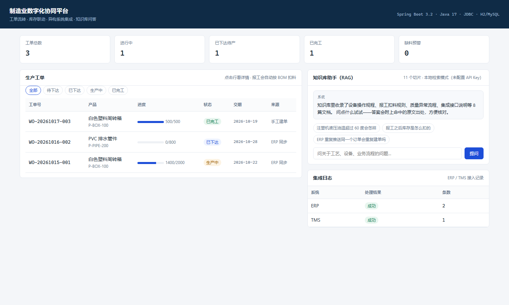
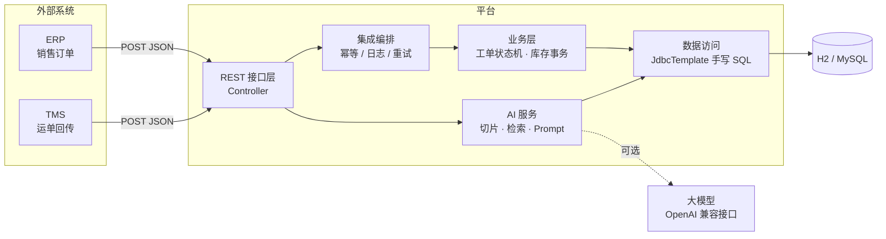

# 制造业数字化协同平台

面向制造企业的轻量数字化系统：**生产工单流转 + 库存联动 + 异构系统集成 + AI 知识库问答**。

不是课程作业式的 CRUD 演示，而是按「能交付、能维护、能解释清楚」的标准做的：

- 报工时的库存扣减和工单状态推进在**同一个事务**里，库存不足整单回滚，不会扣一半
- 外部系统接入做了**幂等**，重复推送不会重复建单，失败可重试
- 知识库问答（RAG）**不配 API Key 也能跑**，自动降级为本地检索，接口永远有返回
- 全部 SQL 手写，没有 ORM 魔法，索引和执行路径可解释



---

## 一、为什么做这个

制造企业的信息化现状通常是：ERP 管订单、MES 管生产、TMS 管运输、CRM 管客户，四套系统各自为政。销售在 ERP 下了单，车间还在用 Excel 排产；工单报了多少、料扣没扣，靠人问。

这个项目解决其中三段：

1. **订单到工单**：ERP 推送销售订单，自动生成生产工单，不用人工转录
2. **工单到物料**：报工时按 BOM 自动扣减库存并留流水，账实可对
3. **经验到知识**：把设备规程、业务规则做成知识库，车间新人直接问，答案带原文出处

---

## 二、系统结构



### 代码分层

```
src/main/java/com/cuijian/digital/
├── common/          统一响应、业务异常、全局异常处理
├── domain/          实体（record）与工单状态机
├── dto/             接口入参 / 出参
├── dao/             8 张表的 SQL，全部 JdbcTemplate 手写
├── service/         工单业务、集成编排、RAG 问答
├── ai/              切片、关键词检索（BM25）、大模型客户端
└── web/             REST 控制器
```

---

## 三、四个关键设计

### 1. 报工是一个完整事务

报工做的事比看起来多：扣库存、写流水、推进工单状态、推进工序。任何一步失败都必须整体回滚。

```java
@Transactional
public Map<String, Object> report(long id, ReportRequest req) {
    // 1. 校验状态与数量（不能超产）
    // 2. 按 BOM 逐料扣减：WHERE stock_qty >= ? 把判断交给数据库
    // 3. 库存不足直接抛异常，前面已扣的料随事务一起还原
    // 4. 写 inventory_txn 流水，记扣减后余额
    // 5. 推进工单状态与工序
}
```

**为什么不用「先查库存再判断」**：并发报工时会双双通过检查再双双扣减，账就成负数了。改成 `UPDATE ... WHERE stock_qty >= ?`，由数据库的行锁保证原子性，返回影响行数 0 就是不够。

冒烟测试里有一条专门验证这个：故意报一个超过库存的量，断言「所有物料库存原封不动」。

### 2. 集成幂等用唯一索引，不用「先查后插」

```java
// 直接 INSERT，靠 (system, biz_type, biz_id) 唯一索引挡重复
public boolean tryAcquire(...) {
    try {
        doInsert(...);
        return true;
    } catch (DuplicateKeyException e) {
        // 上次失败了允许重推，否则正常重试也会被挡
        if ("FAILED".equals(findStatus(...))) {
            deleteForRetry(...);
            doInsert(...);
            return true;
        }
        return false;   // 之前成功处理过，判定为重复
    }
}
```

「先 SELECT 再 INSERT」在并发下会被两条线程同时穿过去，唯一索引才是真正的防线。

### 3. RAG 的检索和生成分开

```
文档 → 切片（按句号断，带重叠） → BM25 检索 topK → 拼 Prompt → 大模型 → 答案 + 出处
```

- **切片**：目标 220 字，相邻片段重叠 40 字，避免答案正好落在切口上被截断
- **检索**：中文用 2-gram 滑动窗口 + IDF 加权，标题命中额外加分。不引第三方分词库，零外部依赖
- **生成**：Prompt 里明确「只能依据参考资料回答，资料里没有就说没有」，抑制模型编造
- **降级**：模型超时 / 没配 Key / 额度用尽，都退到「检索原文直出」，接口不会 500

返回结果里带 `mode` 字段（`LLM` / `RETRIEVAL` / `RETRIEVAL_FALLBACK`），一眼看出走了哪条链路。

> 为什么不用向量检索：演示项目不能强制使用者配 embedding 的 Key，否则 clone 下来跑不动。关键词检索在中文短问答上够用，而且完全可解释。真要上生产应该换 pgvector 或 Milvus + embedding 模型。

### 4. 数据库设计

| 表 | 作用 | 关键索引 |
|---|---|---|
| `material` | 物料主数据 | `uk(code)` |
| `bom_item` | 产品 BOM 单耗 | `uk(product_code, material_code)` |
| `work_order` | 生产工单 | `uk(order_no)`、`idx(status, created_at)`、`idx(source_system, source_order_no)` |
| `work_order_step` | 工单工序 | `idx(work_order_id, seq)` |
| `inventory_txn` | 库存流水 | `idx(material_code, created_at)` |
| `integration_log` | 集成日志 | `uk(system, biz_type, biz_id)`、`idx(status, created_at)` |
| `kb_document` | 知识库文档 | `uk(title)` |
| `kb_chunk` | 文档切片 | `idx(doc_id, seq)` |

工单列表页是「按状态过滤 + 按创建时间倒序」，所以建 `(status, created_at)` 联合索引，避免全表扫 + filesort。

`work_order` 上还有一个 `(source_system, source_order_no)` 索引 —— ERP 建单前要按来源单号反查，这个查询在集成链路上是热点。

---

## 四、快速开始

### 环境

- JDK 17+
- Maven 3.6+
- 不需要装数据库（默认用 H2 文件库）

### 启动

```bash
git clone <repo-url>
cd mes-digital-platform
mvn spring-boot:run
```

打开 <http://localhost:8080>，页面自带 3 张演示工单、8 种物料、8 篇知识文档。

H2 控制台：<http://localhost:8080/h2-console>（JDBC URL `jdbc:h2:file:./data/mesdb`，用户名 `sa`，密码空）

### 切 MySQL

```bash
# 先建库
mysql -uroot -p -e "CREATE DATABASE mes DEFAULT CHARACTER SET utf8mb4;"

# 改 application-mysql.yml 里的账号密码，然后
mvn spring-boot:run -Dspring-boot.run.profiles=mysql
```

表结构会自动建，演示数据用 `MERGE` 写入，可重复执行。

### 跑冒烟测试

```bash
python scripts/smoke_test.py http://localhost:8080
```

覆盖 28 项检查：工单全流程、超量报工拒绝、库存不足回滚、ERP 幂等、RAG 检索命中。

---

## 五、接口一览

| 方法 | 路径 | 说明 |
|---|---|---|
| GET | `/api/work-orders?status=&page=&size=` | 工单分页列表 |
| GET | `/api/work-orders/{id}` | 详情（含工序、BOM、已耗料） |
| POST | `/api/work-orders` | 手工创建工单 |
| POST | `/api/work-orders/{id}/release` | 下达工单 |
| POST | `/api/work-orders/{id}/report` | 报工（扣料 + 推进状态） |
| POST | `/api/integration/erp/sales-orders` | ERP 销售订单接入（幂等） |
| POST | `/api/integration/tms/shipments` | TMS 运单接入（幂等） |
| GET | `/api/integration/logs?limit=` | 集成日志 |
| GET | `/api/integration/stats` | 集成成功/失败统计 |
| POST | `/api/ai/ask` | 知识库问答 |
| POST | `/api/ai/reindex` | 重建切片索引 |
| GET | `/api/ai/status` | 知识库与模型状态 |
| GET | `/api/dashboard/summary` | 看板汇总 |
| GET | `/api/materials` | 物料列表 |
| GET | `/api/bom/{productCode}` | 产品 BOM |
| GET | `/api/inventory/txn?refNo=` | 按工单号反查耗料 |

### 示例：报工

```bash
curl -X POST http://localhost:8080/api/work-orders/2/report \
  -H "Content-Type: application/json" \
  -d '{"qty": 20, "operator": "张伟"}'
```

```json
{
  "code": 0,
  "message": "报工成功",
  "data": {
    "orderNo": "WO-20261016-002",
    "reportedQty": 20,
    "doneQty": 20.0000,
    "planQty": 800.0000,
    "status": "IN_PROGRESS",
    "consumed": [
      {"materialCode": "M-GL-002", "materialName": "PVC 胶体", "qty": 32.00, "unit": "KG", "balanceAfter": 1168.0000}
    ]
  }
}
```

库存不足时：

```json
{"code": 400, "message": "物料 PVC 胶体（M-GL-002）库存不足：需要 1598.40 KG，当前仅剩 1168.00"}
```

---

## 六、接入大模型（可选）

不配也能用，配了答案会更像人话：

```bash
export AI_API_KEY=sk-xxxxxxxx
mvn spring-boot:run
```

默认指向 DeepSeek。换成其他家只改 `application.yml`：

```yaml
app:
  ai:
    base-url: https://api.openai.com/v1    # 或通义、Kimi、本地 Ollama
    api-key: ${AI_API_KEY:}
    model: gpt-4o-mini
```

只要对方兼容 OpenAI 的 `/chat/completions` 协议就能直接切。

---

## 七、技术选型说明

| 选择 | 理由 |
|---|---|
| Spring Boot 3.2 + Java 17 | record、文本块（`"""`）让 SQL 和 DTO 写起来干净 |
| JdbcTemplate 而非 MyBatis/JPA | 索引、执行计划、事务边界都能自己控制，出问题知道去哪查 |
| H2 文件库做默认 | clone 下来不用装数据库就能跑，降低试用门槛 |
| 关键词检索而非向量库 | 零外部依赖、可解释、中文短问答够用（见上文取舍） |
| 原生 JS 单页 | 前端不是这个项目的重点，能看数据就行，不引构建工具 |

---

## 八、已知限制

诚实地列出来，比藏着好：

- **没有权限体系**。真实项目里车间操作工只能报自己班组的工单，这里所有人能改所有单子
- **没有单元测试**。目前靠 `scripts/smoke_test.py` 做端到端验证，DAO 层应该补 JUnit + 内存库测试
- **工单号生成可能并发冲突**。用「当天已建单数 + 1」，高并发下会撞唯一索引；正确做法是号段模式或雪花 ID
- **TMS 回传只记日志**，没有真正建发运单表，因为演示数据里没有发运环节
- **知识库只支持 8 篇内置文档**，没有做上传解析（PDF/Word），切片是全量重建而不是增量
- **无接口鉴权**。外部系统接入应该有签名 + IP 白名单，这里为了演示完整性省略了

---

## 九、后续可以做的

- 补 DAO 层单元测试（JUnit 5 + H2 内存库）
- 工单号换号段模式，去掉并发冲突
- 知识库支持上传 PDF/Word 并自动解析切片
- 检索升级为向量 + 关键词混合（hybrid search），用 pgvector
- 加操作审计表，记录谁在什么时候改了什么
